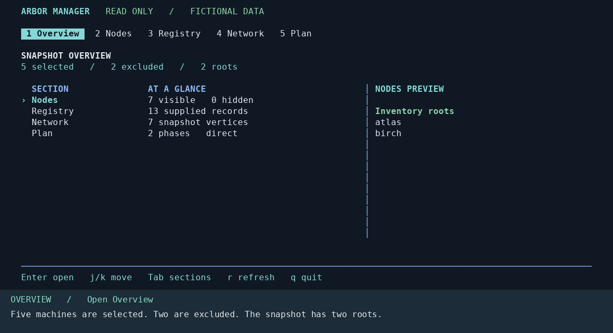
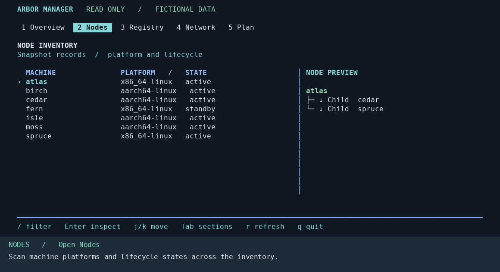
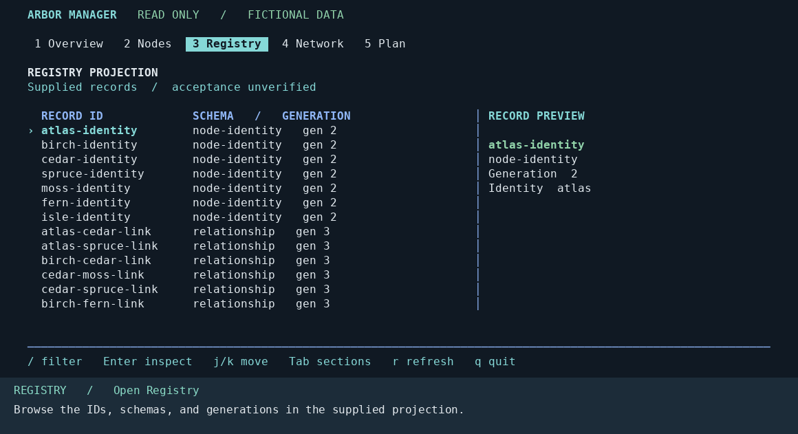
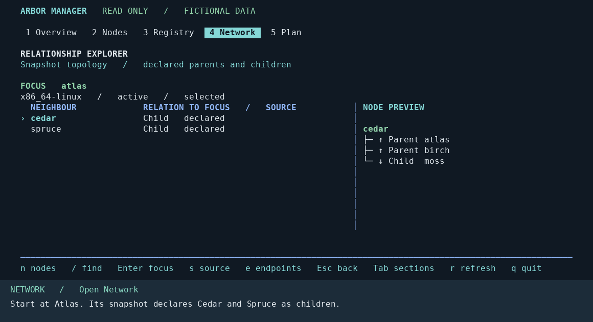
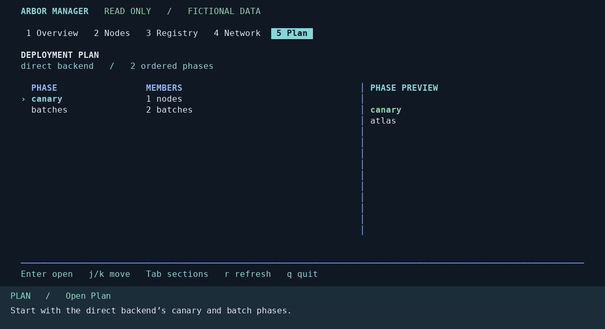

# Arbor Manager

Arbor Manager is the reusable assembly layer between a machine source and
ordinary NixOS configurations. `mkMachines` consumes pure source entries, so
callers can provide records from any source without adding a registry
dependency.

## Explore the terminal interface

Start with a fictional cluster from a checkout of this repository.

```console
nix run .#arbor-manager -- tui --demo
```

Press `1`–`5` to jump to a tab, `j` or `k` to move the selection, and
`Enter` to inspect it. Press `Esc` to go back and `q` to quit. To open a
specific tab on startup, add `--tab network`, for example.



<details>
<summary><strong>Nodes</strong> · Find a machine and inspect its snapshot record</summary>



</details>

<details>
<summary><strong>Registry</strong> · Find a projected record and inspect its generation</summary>



</details>

<details open>
<summary><strong>Network</strong> · Explore Cedar’s parents, child, and projected relationships</summary>



</details>

<details>
<summary><strong>Plan</strong> · Inspect the canary and the next deployment batch</summary>



</details>

[Reproduce these recordings](res/demos/README.md)

## Assemble machines

Its public API is `lib.mkMachines`:

```nix
inputs.arbor-manager.lib.mkMachines {
  inherit inputs;
  sources = [
    {
      name = "server";
      record = { system = "x86_64-linux"; profiles = [ "server" ]; };
      provenance = { kind = "registry-snapshot"; revision = "..."; };
      precedence = 10;
    }
  ];
  profiles = { server = [ ./profiles/server.nix ]; };
}
```

Each source entry has `name` and `record`, and may provide `modules`,
`provenance`, and numeric `precedence`. Records retain `cluster` (including
any relationship fields) as data; Arbor Manager does not prescribe role
values. `localSource ./config/machines` adapts the conventional directory
layout, and `registrySnapshot { digest = "sha256:..."; machines = { name = record; }; }`
adapts an immutable accepted snapshot. Registry snapshot entries contribute
public data only; trusted executable modules are selected by local composition.
The optional `hardware` field must contain exactly one data-only form:

```nix
hardware.snapshot = {
  format = "arbor/hardware";
  version = 1;
  facts = { memoryBytes = 17179869184; cpu = "x86_64-v3"; };
};
# or hardware.artifact = {
#   digest = "sha256:<64 lowercase hex characters>";
#   mediaType = "application/vnd.arbor.hardware+json";
# };
```

Hardware artifacts are references only; Arbor Manager does not fetch or
evaluate them. `hardware.modules` and executable values are rejected. Local
`hardware-configuration.nix` and `configuration.nix` modules remain explicit
members of a local source.

`sourceMerge` combines `registrySnapshot`, `committedLocal`, and an optional
`sessionOverride` per machine field. The result has `sources`, `machines`, and
a deterministic `digest`; each merged field records its layer and original
provenance. Session overrides may use only named `trustedLocalModules` via
`moduleSelectors`. Authority and identity-generation fields cannot be changed,
and duplicate names within a source are rejected.

## Machine and deployment snapshots

`lib.snapshot` provides pure inspection and export helpers. `inspectMachine`
accepts a resolved `mkMachines` entry or a record and returns source and
per-field provenance. `exportMachine` and `exportDeployment` produce
deterministic canonical JSON, while `digest` hashes that JSON. Secret-like
fields, runtime strings, paths, functions, derivations, and functors become
`<redacted>` before serialization, so exports contain no executable Nix or
secret material. Registry snapshots remain immutable data inputs: they supply
no modules; trusted executable code comes only from local composition.

For compatibility, `machinesPath = ./config/machines` remains an alias for
the local adapter. Local directories contain `default.nix` (facts), and may
contain `hardware-configuration.nix` and `configuration.nix` modules.
Directories are discovered deterministically in lexical order. Each result is
still assembled with native `nixosSystem`, with the normalized record exposed
at `config.arbor.machine` and as the `machine` special argument.

## Selection and deployment plans

The pure `lib.graph` function normalizes a node attrset whose optional
`children` and `parents` fields contain node names. `lib.selectors` provides
`local`, `children`, `descendants`, `parents`, `ancestors`, `peers`, and
`accessible`; all results are sorted and cycle-safe. `lib.select` returns the
selected names plus deterministic exclusion records. Nodes with
`reachable = false`, `compatible = false`, disabled nodes, and suspended or
standby nodes (unless explicitly allowed) are excluded with stable reason
strings.

`lib.plan` turns a selection into an inspectable deployment plan. It includes a
canonical snapshot and SHA-256 digest, backend recommendation (`direct` or
`colmena`), critical-route and state risks, canary/batch phases, acknowledgement
digest, and copyable names/commands. Selected names are emitted in graph order;
parents in the selected graph always precede their children, while unreachable,
incompatible, disabled, standby, and suspended targets remain excluded unless
their respective policy allows them. A canary is one first graph-valid node,
and the remaining nodes are partitioned into deterministic batches. The backend
strings are interfaces until an operator explicitly supplies a backend adapter
executable to the CLI. The Nix library still never opens connections or
executes Colmena.

When a plan selects the Colmena backend, `lib.rawHive` projects the same
resolved machine records into a raw Colmena hive. Only `plan.names` become
nodes, so exclusions and an empty plan never imply apply-all. Node records may
provide `targetHost`, `targetPort`, `targetUser` (or a `target` attrset) and
`tags`; these become Colmena deployment metadata. `mkMachines` exposes
`colmenaRawHive`, `colmenaSelection`, and `colmenaHive` only when its `inputs`
contains a Colmena flake input. `colmenaHive` calls that input's `lib.makeHive`
purely; it does not execute deployment.

## Offline CLI

The `arbor-manager` package and app provide inspection without evaluating a
machine configuration or connecting to a host. They accept the immutable JSON
written by `lib.snapshot.deploymentSnapshot`; the wrapper digest and embedded
`snapshotDigest` are verified before any output is produced.

```console
$ nix run .#arbor-manager -- nodes list --snapshot deployment.json --scope selected
api
$ nix run .#arbor-manager -- machine inspect --snapshot deployment.json --name api
$ nix run .#arbor-manager -- machine export --snapshot deployment.json --name api --format json
$ nix run .#arbor-manager -- deployment-plan --snapshot deployment.json --format text
$ nix run .#arbor-manager -- deployment plan --snapshot deployment.json --format text
```

`nodes list` supports `all`, `local`, `selected`, `excluded`, `roots`,
`children`, `descendants`, `parents`, `ancestors`, `peers`, and `accessible`
scopes. Formats are `table`, `names`, `json`, `ssh`, and `colmena`; JSON is
the default. `ssh` and `colmena` are display projections; execution remains an
explicit operator-supplied adapter. Inspection and planning remain offline.
`deployment plan` and `deployment apply --dry-run`
only display the immutable plan. A real `deployment apply` requires the digest (or
token) in the deployment snapshot and an explicit backend executable:

```console
$ nix run .#arbor-manager -- deployment apply --snapshot deployment.json \
    --acknowledgement <digest> --backend-executable ./my-deployer
```

The adapter is invoked once per node in each immutable plan phase, in phase
order, with no shell interpretation. It receives JSON on stdin containing the
selected backend (`direct` or `colmena`), snapshot and acknowledgement digests,
phase, node, risk, and endpoint metadata
(`targetHost`, `targetPort`, and `targetUser`, with `hostname` as the host
fallback). It must return a JSON object on stdout and use exit status zero for
success. The CLI returns structured per-node results and treats a non-zero exit
or invalid JSON as a failed node. It verifies the wrapper and snapshot digests,
immutable plan phases, and acknowledgement before starting; phase names must
be unique members of `snapshot.selected`. If no backend executable is
supplied, apply retains an explicit refusal with exit status 3. For a Colmena
plan, the adapter is the operator-supplied wrapper that turns these verified
requests into the desired `colmena apply` invocation; Arbor Manager does not
treat Colmena as registry truth. No SSH or Colmena networking is built into the
CLI. `--receipt FILE` writes resumable per-node results after each attempt;
`--resume FILE` accepts only a receipt bound to the same snapshot and
acknowledgement digests.

```nix
plan = lib.plan {
  nodes = inventory;
  roots = [ "api" ];
  selector = "accessible";
  batchSize = 2;
};
```

### Terminal interface

Run `nix run .#arbor-manager -- tui --snapshot deployment.json` in a terminal.
The interface validates the snapshot on each refresh. Overview opens the other
sections, Nodes shows snapshot records and their provenance, and Plan shows
the membership of each rollout phase. Use the CLI for risk and acknowledgement
details.

In Network, choose a neighbour and press `Enter` to follow that relationship.
Press `Esc` to retrace your path. The node directory (`n`) includes isolated
nodes, and `/` finds a node by name. Wide terminals show a preview of the
selected neighbour. From a machine’s detail page in Nodes, press `g` to open
its network neighbourhood.

Add `--registry-projection projection.json` to browse a local export of
`Runtime.projection()` and compare its relationships with the snapshot using
`s` in Network. From a trusted local Registry Python environment, serialize an
already-open runtime with `json.dump(runtime.projection(), output_file)`.
Registry shows record IDs, schemas, generations, and selected identity or
relationship fields. The operator supplies this export and is responsible
for verifying its origin and freshness. Press `r` to reread the inputs.

Add `--socket /path/to/network.sock` and press `e` in Network to see separate
counts of accepted and observed endpoint records. Reachability and active
route selection require other evidence.

## Administration console

Run `arbor-manager tui --admin --demo` to rehearse with three fictional roles: a standalone node, a fresh joining node, and its preconfigured authority. Press Enter to accept example values. Use **1** to inspect, **2** to initialize the standalone node, then **3 → 4 → 5** for the separate joining node. **6** edits a Manager state override. **7** checks enrollment prerequisites. Type `APPLY` at the action preview, `:cancel` to go back, or `q` at the menu to quit. The demo discards its files on exit.

### Set up a live console

Install the Registry runtime package on each relevant host. Start its configured daemon and check service availability with `systemctl status arbor-registry.service`. Use an operator account with permission to use the authenticated Registry socket and token. The adapter handles the token. The console needs no deployment snapshot and performs its first Registry call only when you select an action.

```sh
arbor-manager tui --admin --runtime-executable "$(command -v arbor-registry-manager-adapter)" \
  --config /etc/arbor-registry/config.json --overrides "$PWD/session-overrides.json"
```

For an alternate runtime, pass its config JSON path to `--config`. Omit the option to use the adapter default. Supply only a trusted Registry adapter executable: it handles authentication and validates signed public artifacts before returning them. Open **1** to check connectivity and identity. Choose **2** for a new standalone identity, or **3** for a fresh joining node. Initializing a standalone genesis occupies that node's identity slot. Registry retains private identity keys under its runtime key directory. Application passwords and service credentials use Registry's OpenBao runtime bindings and service credential files.

### Enroll a joining node with an existing authority

Use pairing-capable versions of the **daemon and adapter on both hosts**. On each, set `cluster.registry.runtime.bootstrapAuthoritiesFile` to a public JSON file containing `{"keys":{"birch":"<verified-authority-public-key>"}}`, and include `"birch"` in `cluster.registry.runtime.authorityIssuers`. Obtain the public key through your existing trusted provisioning channel. The approver needs the corresponding provisioned signer in its runtime key directory. A standalone genesis only establishes its own identity.

1. On the joining host, open **7**, enter the authority ID and verify that it is trusted and the joining state is new (or pending for a retry). On the authority host, **7** must also report that the local signer is ready.
2. On the joining host, **3** creates a runtime-held identity key and a signed public request. Enter the joining ID, platform, authority ID and a new filename. Transfer that file to the authority and convey the displayed SHA-256 separately over a trusted channel.
3. On the authority, **4** reads the transferred request. Enter the independently obtained digest, choose a new approval filename, review the applicant and confirm. Transfer the signed public approval back to the joining operator.
4. On the original joining host, **5** checks the local pending state and submits the approval to Registry. Registry verifies the signer and the request binding before accepting the identity. Open **1** or **7** to inspect the result. Enrollment establishes identity. Parent/peer relationships, network routes and deployment are separate operations.

Complete the exchange within the request's 15-minute window. If it expires, repeat **3** on the same joining runtime with the original IDs/platform and a new output filename. Transfer the new request and compare its new digest. If a transfer or file write fails, keep the original key and retry with a fresh output path. Existing handoff files are preserved.

### Change Manager planning state

Open **6** and specify an exact inventory node and one of `active`, `standby`, or `suspended`. When adding a new entry you must retype its name. An unknown name creates a machine in the merged inventory. The console displays the change, saves with atomic replacement and reads back the file. Use a dedicated JSON override in an operator-owned directory. A missing file starts as an empty list. Existing Manager list and map forms retain other records and fields.

Consume the file explicitly in the inventory composition, for example:

```nix
let
  inventory = { inherit registrySnapshot committedLocal; };
  base = arbor-manager.lib.sourceMerge inventory;
  overrides = builtins.fromJSON (builtins.readFile ./session-overrides.json);
  names = if builtins.isList overrides then map (entry: entry.name) overrides
          else builtins.attrNames overrides;
  unknown = builtins.filter (name: !(builtins.hasAttr name base.machines)) names;
  merged = arbor-manager.lib.sourceMerge (inventory // { sessionOverride = overrides; });
in
if unknown != [] then throw "Unknown Manager nodes: ${builtins.concatStringsSep ", " unknown}"
else arbor-manager.lib.plan { nodes = merged.machines; roots = [ "fern" ]; }
```

Include that JSON file in the source used for evaluation (for a Git flake, add it to Git). Regenerate the deployment snapshot to see the updated plan. By default selection excludes standby and suspended nodes unless the relevant selection option permits them. This file changes Manager's desired planning input. Observed host health, signed Registry records and running services have separate lifecycles.
